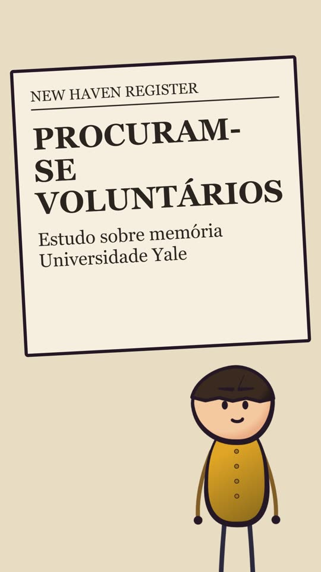

# Estúdio Criativo

Plataforma para criar **roteiros, narração e vídeos curtos animados por código** (Remotion), e depois **agendar e publicar** os vídeos no Instagram, TikTok, Facebook e YouTube, acompanhando as métricas no mesmo lugar.

O nome é provisório. O planejamento completo está em [docs/PLANEJAMENTO.md](docs/PLANEJAMENTO.md) e o registro das fases em [docs/FASE-0.md](docs/FASE-0.md).

---

## Sumário

1. [O que o sistema faz](#o-que-o-sistema-faz)
2. [Como o Claude entra no sistema](#como-o-claude-entra-no-sistema)
3. [Pré-requisitos](#pré-requisitos)
4. [Instalação passo a passo](#instalação-passo-a-passo)
5. [Configuração (`.env.local`)](#configuração-envlocal)
6. [Primeiro acesso](#primeiro-acesso)
7. [Conectar o agente Claude da sua máquina](#conectar-o-agente-claude-da-sua-máquina)
8. [Editor Remotion](#editor-remotion)
9. [Scripts disponíveis](#scripts-disponíveis)
10. [Estrutura do projeto](#estrutura-do-projeto)
11. [Dados, arquivos e o que fica fora do git](#dados-arquivos-e-o-que-fica-fora-do-git)
12. [Testes](#testes)
13. [Solução de problemas](#solução-de-problemas)
14. [Segurança](#segurança)
15. [Status e próximos passos](#status-e-próximos-passos)

---

## O que o sistema faz

O fluxo de produção vai da ideia até o post publicado:

| Área | Para que serve |
|---|---|
| **Ideias** | Chat com o Claude por perfil. Também gera ideias a partir de um nicho. |
| **Roteiros** | Quadro por etapa (ideia → rascunho → aprovado → gravado → publicado), com séries, pesquisa de fatos e lista de fontes. Os botões **Pesquisar fatos** e **Escrever rascunho** usam o Claude. |
| **Vídeos** | Estúdio de vídeo em quatro etapas: narração, cenas, pré-visualização e render MP4. Cada ajuste vira uma nova versão (v1, v2, v3…). |
| **Editor** | Abre o Remotion Studio dentro da própria página, com linha do tempo, props e render. |
| **Agendamento** | Publica nas redes na data marcada. Um agendador interno faz isso a cada minuto. |
| **Métricas** | Coleta visualizações e engajamento por hora, com exportação em CSV. |
| **Perfis** | Personagens e identidade de cada canal. |
| **Vozes** | Vozes da ElevenLabs, com amostra em português, ajuste de estabilidade e velocidade. |
| **Estilos** | Galeria dos estilos visuais: Clássico, Volta por Cima, Bíblia Animada, Mundo Oculto, Matrixxtz 2D e Natan Madeira 3D. |
| **Contas** | Conexão das contas das redes (OAuth). |

Exemplo de quadro gerado pelo sistema (vídeo Milgram, parte 1):



### Estilos de vídeo

Cada estilo é um pacote com paleta, personagens, cenários, legenda e ritmo. O código fica em `packages/video/src/generic/`, e as cenas de exemplo em `amostras.ts`. A galeria em **Estilos** mostra uma prévia animada de cada um.

---

## Como o Claude entra no sistema

O site roda no servidor, mas **as chamadas ao Claude são feitas pelo seu próprio computador**, com a sua conta. Isso tem duas consequências:

- Quem paga o uso é a conta Claude de quem roda o agente (assinatura Pro/Max ou API, conforme o login do Claude Code).
- O servidor nunca recebe a sua credencial do Claude. Ele só entrega tarefas (um texto de pedido) e recebe a resposta.

O caminho é este:

```
Site (servidor)  ──tarefa──▶  Agente local (seu PC)  ──claude -p──▶  Claude (sua conta)
                 ◀─resposta──                       ◀────resposta────
```

São **dois tokens diferentes**. Não confunda:

| Token | O que é | Onde fica | Como consegue |
|---|---|---|---|
| **Token do agente** (`ea_…`) | Identifica o seu PC para o site. Só autoriza receber tarefas e devolver respostas. | Gerado em **Agente local** no site. Guardado no site só como hash. | Botão **Gerar token** na página `/agentes`. |
| **Login do Claude** | A sua conta Claude, usada pelo Claude Code no seu PC. | No Claude Code da sua máquina. | `claude` no terminal, ou `claude setup-token` para um token de longa duração. |

O agente não guarda nem envia a sua conta Claude. Ele só executa `claude -p` na sua máquina e devolve o texto gerado.

---

## Pré-requisitos

| Item | Versão / observação |
|---|---|
| **Node.js** | `20.19+`, `22.13+` ou `24+` (o projeto declara essas faixas). Teste com `node -v`. |
| **npm** | Vem com o Node. |
| **Git** | Para clonar o projeto. |
| **Claude Code** (`claude`) | Obrigatório para as funções de IA. Instale seguindo a documentação oficial do Claude Code e faça o login com a sua conta. |
| **ffmpeg** | Obrigatório para ajustar a velocidade da narração. Precisa estar no PATH (`ffmpeg -version` tem que funcionar). |
| **Chave da ElevenLabs** | Opcional. Só para narração e vozes. |
| **Contas de desenvolvedor das redes** | Opcional. Só para publicar e coletar métricas (Meta, YouTube, TikTok). |

Sistema testado no Windows 11. Nada aqui depende do Windows, mas os caminhos de exemplo usam `\`.

---

## Instalação passo a passo

### 1. Clone o projeto

```bash
git clone <url-do-repositório> estudio-criativo
cd estudio-criativo
```

### 2. Instale as dependências

Rode na **raiz** do projeto. O npm instala todos os pacotes do monorepo (`apps/*` e `packages/*`) de uma vez.

```bash
npm install
```

### 3. Crie o arquivo de configuração

```bash
cp .env.example apps/web/.env.local
```

No Windows (PowerShell): `Copy-Item .env.example apps/web/.env.local`.

Abra `apps/web/.env.local` e troque pelo menos **`SESSION_SECRET`** e **`TOKEN_ENC_KEY`** por textos aleatórios com 32 caracteres ou mais. Veja [Configuração](#configuração-envlocal).

### 4. Suba o site

```bash
npm run dev
```

Abra **http://localhost:3000**. Na primeira vez, o banco de dados é criado e as migrações são aplicadas sozinhas, dentro de `storage/estudio.db`.

### 5. Crie o administrador

Na tela de login, digite o e-mail e a senha que você quer usar. Como ainda não existe nenhum usuário, o **primeiro login cria o administrador**.

### 6. Conecte o Claude

Siga [Conectar o agente Claude da sua máquina](#conectar-o-agente-claude-da-sua-máquina). Sem isso, as funções de IA (Ideias, pesquisa de fatos, rascunhos, cenas) ficam paradas.

---

## Configuração (`.env.local`)

O arquivo fica em **`apps/web/.env.local`**. Ele nunca vai para o git. O modelo está em `.env.example`.

| Variável | Obrigatória | Para que serve |
|---|---|---|
| `SESSION_SECRET` | **Sim** | Assina o cookie de sessão do login. Use um texto aleatório de 32+ caracteres. Trocar isso desconecta todo mundo. |
| `DATABASE_PATH` | Sim | Caminho do banco SQLite. Padrão: `../../storage/estudio.db`. |
| `TOKEN_ENC_KEY` | **Sim** para redes | Chave que cifra os tokens das contas de redes sociais no banco. Use um texto aleatório de 32+ caracteres. Não troque depois de conectar uma conta, senão os tokens salvos deixam de abrir. |
| `ELEVENLABS_API_KEY` | Não | Chave da ElevenLabs para narração e vozes. Fica só no servidor. |
| `APP_URL` | Não | Endereço público do site. Padrão: `http://localhost:3000`. Os retornos do OAuth das redes usam esse endereço. |
| `COLETA_AUTOMATICA` | Não | `1` liga a coleta de métricas de hora em hora dentro do servidor. Padrão: `0`. |
| `AGENDADOR_AUTOMATICO` | Não | `1` liga o agendador que publica no horário marcado. Ligue em **só uma** instância do site, senão publica em dobro. Padrão: `0`. |
| `META_APP_ID`, `META_APP_SECRET` | Não | Instagram e Facebook. |
| `YOUTUBE_CLIENT_ID`, `YOUTUBE_CLIENT_SECRET` | Não | YouTube. |
| `TIKTOK_CLIENT_KEY`, `TIKTOK_CLIENT_SECRET` | Não | TikTok. |

Exemplo de geração de chave aleatória:

```bash
node -e "console.log(require('crypto').randomBytes(32).toString('hex'))"
```

Preencha só as redes que você vai usar. Sem as chaves de uma rede, a conexão dela fica indisponível, e o resto do sistema funciona normalmente.

---

## Primeiro acesso

1. `npm run dev` e abra http://localhost:3000.
2. O primeiro e-mail e senha informados viram o **administrador**.
3. Vá em **Perfis** e cadastre o canal (personagens e identidade).
4. Vá em **Vozes** e importe as vozes da sua conta ElevenLabs, se tiver a chave.
5. Clique em **Conectar agente** no canto inferior da barra lateral (a página é `/agentes`) e siga a seção abaixo.
6. Em **Ideias**, gere ideias pelo nicho ou converse com o Claude sobre um perfil.

---

## Conectar o agente Claude da sua máquina

O agente é um pequeno programa que roda no **seu** computador. Ele pede tarefas ao site, executa `claude -p` com a sua conta e devolve o resultado.

### Passo 1: faça o login no Claude Code

No terminal, uma única vez:

```bash
claude
```

Siga o login pelo navegador. Para conferir se funcionou, rode `claude -p "diga oi"`. Se responder, está pronto.

Se preferir não depender do login interativo (por exemplo, em um computador que roda o agente de forma contínua), gere um token de longa duração:

```bash
claude setup-token
```

O comando mostra um token. Guarde-o com cuidado e defina a variável de ambiente **no mesmo terminal em que vai rodar o agente**:

```bash
# macOS / Linux
export CLAUDE_CODE_OAUTH_TOKEN="<token-gerado>"

# Windows (PowerShell)
$env:CLAUDE_CODE_OAUTH_TOKEN = "<token-gerado>"
```

O Claude Code lê essa variável sozinho. O estúdio não precisa saber dela. Isso é uma credencial da sua conta: não cole em chats, não suba para o git e não compartilhe.

### Passo 2: gere o token do agente no site

1. Entre no site e abra **Agente local** (`/agentes`).
2. Clique em **Gerar token**. Dê um nome ao PC, se quiser (ex.: "Notebook").
3. O token (`ea_…`) aparece **uma única vez**. Copie o comando que a página mostra.

Se você fechar a página sem copiar, gere outro token. O anterior continua válido até você removê-lo.

### Passo 3: rode o agente

Na pasta do projeto, em um terminal separado:

```bash
npm run agente -- --servidor http://localhost:3000 --token <seu-token-ea_>
```

Se o site estiver em outra máquina, troque `http://localhost:3000` pelo endereço dele. Saída esperada:

```
Agente conectado a http://localhost:3000. Ctrl+C para sair.
[tarefa 12] pesquisa_fatos
[tarefa 12] concluída
```

Na página **Agente local** o PC aparece como **online**. Deixe o terminal aberto enquanto usa as funções de IA.

### O que o agente faz e o que não faz

- Usa **só** `claude -p` (texto) e, para pesquisa de fatos, `WebSearch` e `WebFetch`. Não lê nem escreve arquivos e não executa comandos.
- Não guarda sua conta Claude. Não envia sua conta para o site.
- Se o token do agente for revogado, ele para com a mensagem `Token inválido`.
- Se o site cair, ele tenta de novo sozinho.

### Opções úteis do agente

| Opção | Padrão | Para que serve |
|---|---|---|
| `--servidor` | `http://localhost:3000` | Endereço do site. Também pode vir de `AGENTE_SERVIDOR`. |
| `--token` | — | Token do agente (obrigatório). Também pode vir de `AGENTE_TOKEN`. |
| `--intervalo` | `2000` | Milissegundos entre as verificações de tarefa. |
| `--tempo-max` | `300000` | Tempo máximo de uma tarefa, em ms (5 min). |

---

## Editor Remotion

A página **Editor** (`/studio`) abre o **Remotion Studio** dentro do sistema. Você não precisa rodar nada por fora:

1. Entre em **Editor**. Na primeira vez o Studio sobe em segundo plano (pode levar até um minuto).
2. Ele roda a partir de `packages/video`, na porta **3030**.
3. A saída do processo vai para `storage/studio.log`. Se a página mostrar "Não consegui ligar o Remotion Studio", leia esse arquivo.

Para abrir o Studio em tela cheia, use o link **Abrir o Studio em outra aba** na própria página.

Se preferir subir o Studio manualmente (útil para depurar):

```bash
npm run video:studio
```

---

## Scripts disponíveis

Todos rodam na **raiz** do projeto.

| Comando | O que faz |
|---|---|
| `npm install` | Instala as dependências de todo o monorepo. |
| `npm run dev` | Sobe o site em http://localhost:3000 (modo de desenvolvimento). |
| `npm run build` | Gera a versão de produção do site. |
| `npm run video:studio` | Sobe o Remotion Studio manualmente (porta 3030). |
| `npm run agente -- --servidor <url> --token <ea_…>` | Roda o agente Claude da sua máquina. |
| `npm run db:gerar` | Gera uma nova migração a partir do schema (`packages/db/src/schema.ts`). |
| `npm run db:migrar` | Aplica as migrações pendentes. Normalmente não precisa: o site aplica sozinho ao iniciar. |
| `npm run acervo -- --origem "<pasta>"` | Importa roteiros e vídeos de uma pasta antiga (idempotente). |
| `npm test` | Roda os testes do banco de dados (`packages/db`). |

Dentro de `apps/web` também existe `npm test` (testes de agendador e redes).

---

## Estrutura do projeto

```
estudio-criativo/
├── apps/
│   ├── web/              Site Next.js 15 (interface, rotas de API, login)
│   │   └── src/
│   │       ├── app/      Páginas e rotas (/ideias, /roteiros, /videos, /studio, /agentes…)
│   │       ├── lib/      Regras do servidor: agente, agendador, redes, narração, ElevenLabs, Studio
│   │       └── middleware.ts   Exige login nas páginas
│   └── agente/           Agente local (roda no PC de quem usa o Claude)
├── packages/
│   ├── db/               Banco SQLite + Drizzle: schema, migrações e fila de tarefas
│   ├── video/            Remotion: composições, estilos e personagens
│   │   └── src/generic/  Estilos genéricos (Clássico, Volta por Cima, Bíblia, Mundo Oculto, Matrixxtz, Natan 3D)
│   └── redes/            Publicação e métricas: Instagram, YouTube, TikTok, CSV
├── docs/                 Planejamento, fases e guia de estilos
├── scripts/audio/        Scripts de áudio e pós-produção dos vídeos antigos (Python / ffmpeg)
└── storage/              Banco, amostras de voz, MP4 gerados (fora do git)
```

### Fluxo de uma tarefa de IA

1. Você clica em um botão (ex.: **Pesquisar fatos**). O site cria uma linha na tabela `tarefas`.
2. O agente, rodando no seu PC, pega a tarefa em `/api/agente/pegar`.
3. Ele executa `claude -p` com o prompt e as ferramentas permitidas.
4. A resposta volta por `/api/agente/concluir`, e a tela é atualizada.
5. Se a execução falhar, o erro aparece na tela, com a causa.

As tarefas têm retentativas (ver `packages/db/src/fila.ts`).

---

## Dados, arquivos e o que fica fora do git

| Caminho | Conteúdo | No git? |
|---|---|---|
| `apps/web/.env.local` | Suas chaves e segredos | **Não** |
| `storage/estudio.db` | Banco de dados (usuários, roteiros, vídeos, métricas) | **Não** |
| `storage/acervo/` | MP4 renderizados e importados | **Não** |
| `storage/studio.log` | Saída do Remotion Studio | **Não** |
| `packages/video/public/` | Mídias usadas pelos vídeos (modelos, texturas, áudios) | **Não** |
| `node_modules/`, `.next/`, `out/` | Dependências e builds | **Não** |

Faça backup de `storage/` se quiser preservar o trabalho. Os roteiros e metadados estão no banco; os vídeos ficam em arquivos.

---

## Testes

```bash
npm test                  # banco de dados (packages/db)
npm test -w @estudio/web  # agendador e redes (apps/web)
```

Os testes usam dados falsos. Eles não publicam em redes nem gastam créditos da ElevenLabs ou do Claude.

---

## Solução de problemas

| Sintoma | Causa provável | O que fazer |
|---|---|---|
| Página de IA fica parada ou mostra "agente offline" | O agente não está rodando ou o token está errado | Rode `npm run agente -- …` no PC e confira o token em **Agente local**. |
| Agente mostra `Token inválido` | Token revogado, copiado errado ou de outro site | Gere um token novo em `/agentes`. |
| Agente mostra `não consegui executar "claude"` | Claude Code não está instalado ou não está no PATH | Instale o Claude Code e teste `claude -p "oi"` no terminal. |
| Agente mostra erro de login do Claude | Sessão expirou | Rode `claude` de novo e faça o login, ou gere um novo `claude setup-token`. |
| Narração falha ao mudar a velocidade | ffmpeg ausente | Instale o ffmpeg e confira `ffmpeg -version`. |
| "Não consegui ligar o Remotion Studio" | Porta 3030 ocupada ou erro de build | Veja `storage/studio.log`. Se a porta estiver presa, feche o processo que a usa e recarregue a página. |
| Site não abre após `npm run dev` | Porta 3000 ocupada | Feche o outro processo ou use `npm run dev -w @estudio/web -- -p 3001`. |
| Conta de rede desconecta sozinha | `TOKEN_ENC_KEY` mudou | Restaure a chave antiga ou conecte a conta de novo. |
| Publicação acontece duas vezes | `AGENDADOR_AUTOMATICO=1` em mais de uma instância | Deixe ligado em só uma instância. |
| Aviso do Next sobre "multiple lockfiles" | Há um `package-lock.json` fora do projeto | Não afeta o funcionamento. Para silenciar, defina `outputFileTracingRoot` em `apps/web/next.config.ts`. |

---

## Segurança

- **Nunca** commite `.env`, `.env.local`, `storage/` nem tokens. O `.gitignore` já cobre esses caminhos.
- O token do agente é guardado no banco **só como hash SHA-256**. Ele aparece uma única vez, na tela de criação.
- Os tokens das contas de redes são cifrados com `TOKEN_ENC_KEY`.
- O agente executa apenas `claude -p`, com as ferramentas de leitura da web liberadas. Não há acesso a arquivos ou comandos do seu PC.
- O site fica atrás de login. As rotas de agente usam o token do agente, não a sessão do navegador.
- Se um token vazar, revogue-o em **Agente local** e gere outro. Se a conta Claude vazar, faça logout e troque a senha da conta, ou gere um novo `setup-token` e revogue o antigo.

---

## Status e próximos passos

O sistema está em desenvolvimento ativo. Resumo por fase (detalhes em `docs/`):

- **Fase 0**: base do monorepo, banco, fila de tarefas, login e perfis.
- **Fase 1**: agente local, roteiros com pesquisa de fatos, vozes, estúdio de vídeo e redesenho da interface.
- **Fase 3**: métricas, OAuth e publicadores de YouTube, TikTok e Instagram.
- **Fase 4**: agendamento de publicações e agendador automático.

Consulte o histórico do git para ver o que já foi entregue em cada fase.

O detalhamento está em [docs/PLANEJAMENTO.md](docs/PLANEJAMENTO.md) e [docs/FASE-0.md](docs/FASE-0.md). O guia visual dos estilos está em [docs/ESTILOS.md](docs/ESTILOS.md).
